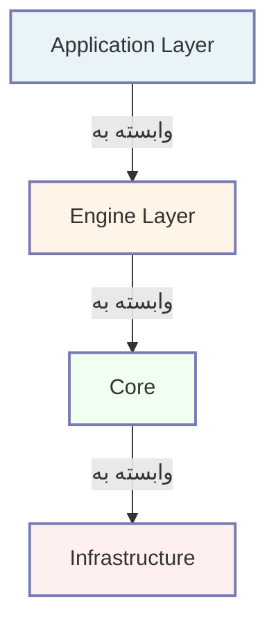

# تَوان | Tavaan

### فریمورک PHP بدون وابستگی بیرونی در زمان اجرا، با زبان فارسی در مرکز

**ساخته‌شده برای جامعهٔ فارسی‌زبان — در زمان اجرا نه پوشهٔ `vendor/` وجود دارد و نه Composer. همهٔ اجزای زمان اجرا خودنوشت، روشن و بازبینی‌پذیرند.**

 

 

### فهرست مطالب

[تَوان چیست؟](#تَوان-چیست) · [چرا تَوان به وجود آمد؟](#چرا-تَوان-به-وجود-آمد) · [خدمت به جامعهٔ فارسی‌زبان](#خدمت-به-جامعهٔ-فارسی‌زبان) · [اصطلاحات کلیدی](#اصطلاحات-کلیدی) · [ویژگی‌ها](#ویژگی‌های-کلیدی) · [اصول بنیادین](#اصول-بنیادین) · [معماری](#معماری) · [مخازن رسمی](#مخازن-رسمی) · [نقشهٔ راه](#نقشهٔ-راه) · [مشارکت](#مشارکت) · [پروانه](#پروانه) · [ارتباط](#ارتباط)

---

## تَوان چیست؟

**تَوان** یک فریمورک (چارچوب نرم‌افزاری) برای زبان PHP نسخهٔ ۸.۲ و بالاتر است که با این باور بنیادین ساخته شده:

> یک فریمورک نباید شما را به خودش وابسته کند.

نام «تَوان» از ریشهٔ فارسی «توان» برمی‌آید؛ به معنای توانایی، توانمندی و توانمندسازی. این نام انتخاب شد چون هدف فریمورک، **توانمند ساختن توسعه‌دهنده** است، نه تبدیل شدن به لایه‌ای که بدون آن نمی‌توان کاری از پیش برد.

### بدون وابستگی در زمان اجرا

در دل تَوان، **هیچ وابستگی بیرونی در زمان اجرا وجود ندارد**. در محیط تولید (production)، نه به Composer نیاز است و نه به پوشهٔ `vendor/`. هر خط کدی که در محیط تولید اجرا می‌شود، خودنوشت، روشن و بازبینی‌پذیر است. این یعنی تیم شما می‌داند دقیقاً چه کدی در سرویس‌اش در حال اجراست، از کجا آمده و چرا آن‌جا قرار گرفته.

> **یادداشت دربارهٔ ابزارهای توسعه:** «بدون وابستگی در زمان اجرا» به معنای «هیچ ابزار توسعه‌ای استفاده نمی‌شود» نیست. ابزارهایی مانند PHPStan، PHP CS Fixer و PHPUnit **فقط در `require-dev`** قرار می‌گیرند و در زمان اجرای سامانهٔ تولید حضور ندارند. برای جزئیات بیشتر، فایل [`CONTRIBUTING.md`](./CONTRIBUTING.md) را ببینید.

این پروژه برای کسانی ساخته شده که می‌خواهند سامانه‌های بزرگ و پایدار بسازند، بدون آنکه زنجیره‌ای از وابستگی‌های ناشناخته را به جان بخرند — سامانه‌هایی که سال‌ها قرار است در محیط تولید کار کنند و هر روز باید بتوان آن‌ها را فهمید، تغییر داد و نگه‌داشت.

---

## چرا تَوان به وجود آمد؟

بسیاری از فریمورک‌های PHP موجود، سرعت توسعه را در روزهای نخست بالا می‌برند؛ اما در مسیر طولانی، هزینه‌هایی پنهان به همراه دارند که گاهی دیرهنگام آشکار می‌شوند:

<table dir="rtl">
  <thead>
    <tr>
      <th style="width: 25%;">چالش</th>
      <th style="width: 50%;">توضیح</th>
      <th style="width: 25%;">پیامد در بلندمدت</th>
    </tr>
  </thead>
  <tbody>
    <tr>
      <td><strong>وابستگی زنجیره‌ای</strong></td>
      <td>یک پکیج کوچک، ده‌ها پکیج دیگر را با خود می‌کشد و شما ناگهان کدی را اجرا می‌کنید که هرگز نخوانده‌اید.</td>
      <td>ناتوانی از کنترل کد در حال اجرا</td>
    </tr>
    <tr>
      <td><strong>ریسک امنیتی پنهان</strong></td>
      <td>یک آسیب‌پذیری در عمیق‌ترین لایهٔ زنجیرهٔ وابستگی‌ها، می‌تواند کل پروژهٔ شما را به خطر بیندازد.</td>
      <td>خطر نشت داده و از دست رفتن اعتماد</td>
    </tr>
    <tr>
      <td><strong>چرخهٔ ارتقای اجباری</strong></td>
      <td>با هر نسخهٔ فریمورک، موجی از تغییرات وابستگی‌ها به راه می‌افتد و زمان تیم را هدر می‌دهد.</td>
      <td>اتلاف زمان برای کارهای بدون ارزش افزوده</td>
    </tr>
    <tr>
      <td><strong>کاهش روشنی کد</strong></td>
      <td>وقتی خطایی رخ می‌دهد، ردیابی آن از میان لایه‌های متعدد بیرونی دشوار و گاه ناممکن می‌شود.</td>
      <td>رفع اشکال طولانی و پرهزینه</td>
    </tr>
    <tr>
      <td><strong>غریب بودن دادهٔ ایرانی</strong></td>
      <td>بسیاری از فریمورک‌ها برای دادهٔ انگلیسی‌محور طراحی شده‌اند و پشتیبانی از دادهٔ ایرانی، حاشیه‌ای است.</td>
      <td>نیاز به ساخت ابزارهای بومی‌ساز، تک‌تک و پراکنده</td>
    </tr>
  </tbody>
</table>

تَوان این چالش‌ها را با رویکردی متفاوت حل می‌کند: **بدون وابستگی بیرونی در زمان اجرا**، کدی کاملاً روشن، و قواعد سخت‌گیرانهٔ PHP مدرن که از ورود الگوهای خطرناک جلوگیری می‌کند.

اینجا کسی به شما نمی‌گوید «این رفتار از فلان پکیج می‌آید، باید منتظر آپدیت آن بمانید». اینجا هر رفتار، در کد خود تَوان قابل ردیابی است و تیم شما می‌تواند آن را بفهمد، بازنویسی کند یا جایگزین نماید.

---

## خدمت به جامعهٔ فارسی‌زبان

تَوان تنها یک فریمورک بدون‌وابستگی نیست؛ یک فریمورک **با زبان فارسی در مرکز** است.

در بسیاری از فریمورک‌های موجود، پشتیبانی از تقویم جلالی، ارقام فارسی، کد ملی، شمارهٔ شبا و سایر داده‌های ایرانی، به‌صورت افزونه‌های جانبی و غیررسمی ارائه می‌شود. نتیجه این می‌شود که توسعه‌دهندهٔ ایرانی برای ساخت یک سامانهٔ سادهٔ فروشگاهی، باید ده‌ها قطعهٔ پراکنده را با هم بچسباند و بعد مدام نگران سازگاری آن‌ها با یکدیگر باشد.

تَوان این نیازها را به جای حاشیه، در مرکز خود پذیرفته است. در این فریمورک، دادهٔ ایرانی یک شهروند درجهٔ اول است، نه افزونه‌ای دیررس.

<table dir="rtl">
  <thead>
    <tr>
      <th style="width: 30%;">قابلیت بومی (هدف طراحی)</th>
      <th style="width: 70%;">توضیح</th>
    </tr>
  </thead>
  <tbody>
    <tr><td>📅 تقویم جلالی</td><td>محاسبهٔ دقیق تاریخ شمسی، تبدیل دوطرفه با میلادی، پشتیبانی از اعیاد و روزهای خاص</td></tr>
    <tr><td>🔢 ارقام فارسی</td><td>نمایش و ورود ارقام فارسی در سراسر فریمورک، با امکان تبدیل خودکار</td></tr>
    <tr><td>🪪 کد ملی</td><td>اعتبارسنجی دقیق کد ملی ایرانی با الگوریتم رسمی</td></tr>
    <tr><td>🏦 شمارهٔ شبا (IBAN)</td><td>اعتبارسنجی شمارهٔ حساب بانکی ایرانی به‌صورت پیشوند `IR...` با الگوریتم IBAN</td></tr>
    <tr><td>💳 کارت بانکی</td><td>اعتبارسنجی شمارهٔ کارت ۱۶ رقمی با الگوریتم لان</td></tr>
    <tr><td>📮 کد پستی</td><td>اعتبارسنجی کد پستی ۱۰ رقمی ایران</td></tr>
    <tr><td>🏢 شناسهٔ شرکت</td><td>اعتبارسنجی شناسهٔ ملی شرکت‌های ایرانی</td></tr>
    <tr><td>🌐 پیام‌های دوزبانه</td><td>خروجی خطا و گزارش، به فارسی و انگلیسی، قابل تغییر در زمان اجرا</td></tr>
    <tr><td>🔒 پوشاندن داده</td><td>پوشاندن دادهٔ حساس (masking) برای پاسخ‌گویی به الزامات حریم خصوصی</td></tr>
    <tr><td>🇮🇷 درگاه‌های پرداخت ایرانی</td><td>پشتیبانی بومی از درگاه‌های بانکی رایج ایران</td></tr>
  </tbody>
</table>

> **یادداشت وضعیت:** این جدول **اهداف طراحی** تَوان را نشان می‌دهد. وضعیت پیاده‌سازی هر قابلیت پس از انتشار عمومی مخزن [`Tavaan-Framework`](#مخازن-رسمی) اعلام خواهد شد.

هدف این است که توسعه‌دهندهٔ فارسی‌زبان، برای ساخت یک سامانهٔ ایرانی، مجبور نباشد ابتدا ابزارهای ایرانی‌ساز را بسازد. این ابزارها باید از روز نخست، بخشی طبیعی از فریمورک باشند — درست همان‌طور که تقویم میلادی یا ارقام لاتین در فریمورک‌های دیگر طبیعی‌اند.

تَوان برای این ساخته شده که فاصلهٔ میان «یک ایدهٔ ایرانی» و «یک سامانهٔ آمادهٔ ایرانی» را کمتر کند.

---

## اصطلاحات کلیدی

در راهنماهای فنی، گاه اصطلاحاتی به‌کار می‌روند که بدون توضیح، گنگ می‌مانند. در ادامه، اصطلاح‌های بنیادین تَوان به‌صورت روشن معرفی می‌شوند تا هر خواننده‌ای، چه تازه‌وارد و چه باتجربه، معنای دقیق آن‌ها را بداند.

<table dir="rtl">
  <thead>
    <tr>
      <th style="width: 22%;">اصطلاح</th>
      <th style="width: 25%;">معادل روشن</th>
      <th style="width: 53%;">توضیح کاربردی</th>
    </tr>
  </thead>
  <tbody>
    <tr><td><strong>بدون وابستگی در زمان اجرا</strong> (Zero Runtime Deps)</td><td>بدون پکیج بیرونی در زمان اجرا</td><td>در محیط تولید، نه به Composer نیاز است و نه به پوشهٔ `vendor/`. تمام اجزای بنیادی فریمورک خودنوشت‌اند. ابزارهای توسعه (مانند PHPStan) در `require-dev` قرار می‌گیرند و در زمان اجرا حضور ندارند.</td></tr>
    <tr><td><strong>فارسی در مرکز</strong> (Persian-First)</td><td>پشتیبانی بومی از دادهٔ ایرانی در سطح هسته</td><td>تقویم جلالی، ارقام فارسی، قواعد اعتبارسنجی ایرانی و پیام‌های دوزبانه، از روز نخست بخشی از خود فریمورک‌اند، نه افزونه‌ای جانبی.</td></tr>
    <tr><td><strong>توانمندی بدون مرز</strong> (Infinite Capability)</td><td>شعار پروژه؛ نشان‌دهندهٔ توانمندی بدون محدودیت</td><td>این شعار می‌گوید با حذف زنجیرهٔ وابستگی‌ها، توان توسعه‌دهنده برای ساخت هر سامانه‌ای — از وبلاگ ساده تا سامانهٔ برنامه‌ریزی منابع سازمان (ERP) — محدود نخواهد بود.</td></tr>
    <tr><td><strong>موتور</strong> (Engine)</td><td>واحد مستقل و خودکفا با مرز سخت</td><td>هر موتور، قرارداد (رابط)، فراهم‌کننده، تست‌ها، مستندات و معیار سنجش اختصاصی خود را دارد و می‌تواند به‌صورت جداگانه آزمود و جایگزین شود.</td></tr>
    <tr><td><strong>مبتنی بر قرارداد</strong> (Contract-First)</td><td>هر خروجی عمومی یک قرارداد روشن دارد</td><td>این رویکرد، امکان بازنویسی و جایگزینی اجزا را بدون شکستن کد فراهم می‌کند.</td></tr>
    <tr><td><strong>معماری ترکیبی</strong> (Hybrid Architecture)</td><td>ترکیب چند الگوی معماری در یک ساختار یکپارچه</td><td>تَوان از الگوهای HMVC، مونولیت ماژولار، رویدادمحور، لایه‌ای و شش‌ضلعی به‌صورت هماهنگ بهره می‌برد.</td></tr>
    <tr><td><strong>مبتنی بر موتور</strong> (Engine-Driven)</td><td>معماری مبتنی بر موتورهای مستقل</td><td>هر قابلیت، در قالب یک موتور مستقل پیاده‌سازی می‌شود با مرز سخت و قرارداد روشن.</td></tr>
    <tr><td><strong>منبع یکتای حقیقت</strong> (SSOT)</td><td>منبع واحد و معتبر</td><td>مستندات و کد مرجع، هر یک در یک مخزن و به‌عنوان تنها مرجع معتبر نگهداری می‌شوند.</td></tr>
    <tr><td><strong>بارگذار خودکار</strong> (Autoloader)</td><td>ابزار بارگذاری خودکار کلاس‌ها</td><td>ابزاری خودنوشت که جایگزین Composer در زمان اجرا می‌شود و کلاس‌ها را خودکار بارگذاری می‌کند.</td></tr>
    <tr><td><strong>نگهدارنده</strong> (Container)</td><td>نگهدارندهٔ وابستگی‌ها (DI Container)</td><td>ابزاری برای مدیریت و تزریق وابستگی‌ها در میان اجزای سامانه، خودنوشت و بدون پکیج بیرونی.</td></tr>
    <tr><td><strong>گذرگاه رویداد</strong> (Event Bus)</td><td>مسیر انتقال رویداد میان اجزا</td><td>سازوکاری که اجزای سامانه را از طریق رویدادها (نه فراخوانی مستقیم) با هم گفت‌وگو می‌کند.</td></tr>
    <tr><td><strong>صندوق خروجی</strong> (Outbox)</td><td>الگوی پایداری رویداد</td><td>الگویی که تضمین می‌کند رویدادها حتی در صورت شکست سامانه، از دست نمی‌روند.</td></tr>
    <tr><td><strong>جدایی خواندن و نوشتن</strong> (CQRS)</td><td>جدایی مسئولیت خواندن و نوشتن</td><td>الگویی که خواندن و نوشتن داده را از هم جدا می‌کند تا هر یک بتوانند مستقل بهینه شوند.</td></tr>
    <tr><td><strong>منبع‌نویسی رویداد</strong> (Event Sourcing)</td><td>ذخیرهٔ تاریخچهٔ همهٔ تغییرات</td><td>الگویی که همهٔ تغییرات حالت سامانه را به‌صورت رویداد ذخیره می‌کند تا هر زمان بتوان تاریخچه را بازسازی کرد.</td></tr>
    <tr><td><strong>معماری شش‌ضلعی</strong> (Hexagonal)</td><td>درگاه‌ها و سازگارها (Ports &amp; Adapters)</td><td>الگویی که منطق کسب‌وکار را از جزئیات فنی (پایگاه داده، پروتکل وب و ...) جدا می‌کند.</td></tr>
  </tbody>
</table>

---

## ویژگی‌های کلیدی

> **یادداشت مهم:** ویژگی‌های زیر **اهداف طراحی** تَوان هستند. وضعیت پیاده‌سازی هر ویژگی پس از انتشار عمومی مخزن [`Tavaan-Framework`](#مخازن-رسمی) اعلام خواهد شد. ستون «وضعیت» نشان‌دهندهٔ مرحلهٔ فعلی هر ویژگی است.

<table dir="rtl">
  <thead>
    <tr>
      <th style="width: 6%;">—</th>
      <th style="width: 28%;">ویژگی</th>
      <th style="width: 50%;">توضیح</th>
      <th style="width: 16%;">وضعیت</th>
    </tr>
  </thead>
  <tbody>
    <tr><td>🚫</td><td><strong>بدون وابستگی در زمان اجرا</strong></td><td>بدون پوشهٔ `vendor/` و بدون Composer در زمان اجرا — بارگذار خودکار کاملاً خودنوشت.</td><td>طرح</td></tr>
    <tr><td>🇮🇷</td><td><strong>فارسی در مرکز</strong></td><td>تقویم جلالی، ارقام فارسی، قواعد اعتبارسنجی ایرانی و پوشاندن دادهٔ ایرانی، در سطح هسته.</td><td>طرح</td></tr>
    <tr><td>💉</td><td><strong>نگهدارندهٔ کامل وابستگی‌ها</strong></td><td>تزریق خودکار با ReflectionCache، اتصال بافتارمند، تشخیص چرخه با مسیر کامل.</td><td>طرح</td></tr>
    <tr><td>⚙️</td><td><strong>معماری مبتنی بر موتور</strong></td><td>موتورهای مستقل با مرز سخت (رابط + فراهم‌کننده + تست + مستندات + معیار سنجش).</td><td>طرح</td></tr>
    <tr><td>🔒</td><td><strong>ایمن در برابر کد منسوخ‌شده</strong></td><td>قواعد سخت‌گیرانهٔ PHP 8.2 به‌علاوهٔ یک دروازهٔ خودکار که از ورود الگوهای ممنوع جلوگیری می‌کند.</td><td>طرح</td></tr>
    <tr><td>📐</td><td><strong>مبتنی بر قرارداد</strong></td><td>همهٔ رابط‌ها در `core/Contracts/` — هر خروجی عمومی یک قرارداد روشن دارد.</td><td>طرح</td></tr>
    <tr><td>🧪</td><td><strong>آزمونگر بومی</strong></td><td>بدون PHPUnit — آزمون با دستور بومی.</td><td>طرح</td></tr>
    <tr><td>🏗️</td><td><strong>آمادهٔ میکروسرویس</strong></td><td>معماری لایه‌ای + شش‌ضلعی + رویدادمحور برای مهاجرت تدریجی به میکروسرویس.</td><td>طرح</td></tr>
  </tbody>
</table>

> **راهنمای وضعیت‌ها:**
> - **طرح**: ویژگی به‌عنوان هدف طراحی تعریف شده است.
> - **در دست توسعه**: پیاده‌سازی در جریان است.
> - **پیاده‌سازی‌شده**: آمادهٔ استفاده است.

---

## اصول بنیادین

تَوان بر چند اصل بنیادین استوار است. این اصول، نقشهٔ راه و خط‌مشی پروژه‌اند و در طول زمان تغییر نمی‌کنند.

### ۱. بدون وابستگی در زمان اجرا

هیچ پکیج بیرونی در زمان اجرا وجود ندارد. بارگذار خودکار، نگهدارندهٔ وابستگی‌ها، گذرگاه رویداد و سایر اجزای بنیادی، همگی خودنوشت‌اند. این یعنی کد شما در محیط تولید، روشن و قابل ممیزی است و هیچ وابستگی پنهانی که نتوانید کنترلش کنید، در کار نیست.

**پیامد عملی:** اگر روزی یک آسیب‌پذیری در یک پکیج بیرونی پیدا شود، شما درگیر آن نیستید. اگر روزی نسخهٔ PHP ارتقا یابد، شما خودتان تصمیم می‌گیرید چه زمانی و چگونه با آن سازگار شوید.

**یادداشت دربارهٔ ابزار توسعه:** ابزارهایی مانند PHPStan، PHP CS Fixer و PHPUnit **فقط در `require-dev`** قرار می‌گیرند و در زمان اجرای سامانهٔ تولید حضور ندارند. این جدایی روشن، «بدون وابستگی در زمان اجرا» را حفظ می‌کند و در عین حال، ابزارهای مدرن توسعه را در اختیار تیم می‌گذارد.

### ۲. فارسی در مرکز

پشتیبانی از دادهٔ ایرانی در سطح هسته، نه به‌عنوان افزونه‌ای جانبی. تقویم جلالی، ارقام فارسی، قواعد اعتبارسنجی ایرانی و پیام‌های دوزبانه، بخشی از خود فریمورک‌اند.

**پیامد عملی:** یک تیم ایرانی می‌تواند یک سامانهٔ فروشگاهی، آموزشی یا مالی بسازد و در آن، کدملی، شبا، کارت بانکی و تقویم جلالی را به‌صورت بومی و اعتبارسنجی‌شده داشته باشد، بدون نیاز به افزودن پکیج‌های جانبی.

### ۳. معماری مبتنی بر موتور

تَوان بر پایهٔ «موتور» ساخته شده است؛ واحدهایی مستقل، خودکفا و دارای مرزهای سخت. هر موتور قرارداد (رابط)، فراهم‌کننده، تست و مستندات اختصاصی خود را دارد. این رویکرد، سامانه را برای دامنه‌های بزرگ و مهاجرت تدریجی به میکروسرویس آماده می‌کند.

### ۴. مبتنی بر قرارداد

هر خروجی عمومی، یک قرارداد روشن دارد. این یعنی می‌توان اجزای فریمورک را بدون ترس از شکستن کد، بازنویسی یا جایگزین کرد. قراردادها در `core/Contracts/` نگهداری می‌شوند و مرجع نهایی رفتار هر موتور هستند.

### ۵. امنیت ذاتی

امنیت در تَوان لایه‌ای نیست که بعداً اضافه شود؛ در ساختار هر موتور نهفته است. از احراز هویت و کنترل دسترسی تا ممیزی زنجیره‌ای و محافظت در برابر حملات رایج وب، همگی به‌صورت بومی پیاده‌سازی می‌شوند.

### ۶. کدنویسی سخت‌گیرانه

قواعد سخت‌گیرانهٔ PHP 8.2 به‌علاوهٔ یک دروازهٔ خودکار که از ورود الگوهای ممنوع جلوگیری می‌کند: هیچ `eval`، هیچ `putenv`، هیچ پراپرتی پویا، و هیچ الحاق رشته‌ای در کوئری‌های SQL.

**پیامد عملی:** کد تَوان در برابر کدهای منسوخ‌شده (deprecated) مقاوم است و در ارتقا به نسخه‌های آیندهٔ PHP، کمتر دچار شکستگی خواهد شد.

---

## معماری

تَوان بر پایهٔ یک **معماری ترکیبی** بنا شده است که نقاط قوت چند الگو را در یک ساختار یکپارچه ترکیب می‌کند:

> **ترجمهٔ فارسی لایه‌ها (بالا به پایین):**
>
> ۱. **لایهٔ اپلیکیشن** — شامل `app/`، `modules/`، `kits/`، `plugins/`
>
> ۲. **لایهٔ موتور** — موتورهای مستقل با مرز سخت (رابط + فراهم‌کننده + تست + مستندات + معیار سنجش)
>
> ۳. **هسته** — رابط‌ها، بارگذار خودکار، اپلیکیشن، راه‌اندازی، خطا، نما، پشتیبانی
>
> ۴. **زیرساخت** — PHP 8.2+ خالص (بدون پوشهٔ `vendor/` در زمان اجرا)

 

### الگوهای به‌کاررفته

<b>📐 HMVC (سلسله‌مراتبی)</b> — سلسله‌مراتب کنترل‌ها برای ماژولار بودن واقعی

در HMVC، کنترلرها می‌توانند به‌صورت سلسله‌مراتبی فراخوانی شوند؛ یعنی یک کنترلر می‌تواند درخواست دیگری را به کنترلری دیگر بفرستد و خروجی آن را در خود بگنجاند. این الگو، ماژولار بودن واقعی را ممکن می‌کند: هر ماژول می‌تواند مستقل باشد و در عین حال با ماژول‌های دیگر همکاری کند.

<b>🏗️ مونولیت ماژولار</b> — یکپارچگی مونولیت با انسجام ماژولار

مونولیت ماژولار به شما اجازه می‌دهد یک سامانهٔ یکپارچه بسازید که در آن هر ماژول مرز روشن خود را دارد، اما همچنان به‌عنوان یک فرایند واحد اجرا می‌شود. این بهترین نقطهٔ شروع برای تیم‌هایی است که می‌خواهند بعداً به میکروسرویس مهاجرت کنند.

<b>⚡ رویدادمحور</b> — با گذرگاه رویداد، صندوق خروجی، جدایی خواندن و نوشتن و منبع‌نویسی رویداد بومی

در معماری رویدادمحور، اجزا به‌جای فراخوانی مستقیم، از طریق رویدادها با هم گفت‌وگو می‌کنند. این یعنی یک جزء می‌تواند رویدادی را منتشر کند و چند جزء دیگر به آن واکنش نشان دهند، بدون آنکه ناشی رویداد بداند چه کسی گوش می‌دهد. تَوان از گذرگاه رویداد، صندوق خروجی (برای پایداری رویداد)، جدایی خواندن و نوشتن (CQRS) و منبع‌نویسی رویداد (Event Sourcing) به‌صورت بومی پشتیبانی می‌کند.

<b>🧅 معماری لایه‌ای</b> — جدایی روشن لایه‌ها

در معماری لایه‌ای، هر لایه مسئولیت روشنی دارد: لایهٔ اپلیکیشن منطق کسب‌وکار را اجرا می‌کند، لایهٔ موتور قابلیت‌های فنی را فراهم می‌کند، لایهٔ هسته قراردادها و ابزارهای بنیادی را نگه می‌دارد، و لایهٔ زیرساخت با دنیای بیرون گفت‌وگو می‌کند. این جدایی، فهم و نگه‌داشت کد را آسان می‌کند.

<b>🔷 معماری شش‌ضلعی</b> — Ports &amp; Adapters برای مهاجرت تدریجی به میکروسرویس

معماری شش‌ضلعی (یا Ports & Adapters) می‌گوید منطق کسب‌وکار نباید به جزئیات فنی (مانند نوع پایگاه داده یا پروتکل وب) وابسته باشد. در تَوان، این یعنی می‌توان یک موتور را بدون تغییر در منطق، با پایگاه داده‌ای متفاوت یا پروتکلی جدید کار کرد. این ویژگی، آماده بودن برای مهاجرت تدریجی به میکروسرویس را فراهم می‌کند.

در این معماری، هر موتور یک واحد مستقل است که قرارداد، فراهم‌کننده، تست‌ها، مستندات و معیار سنجش اختصاصی خود را دارد. این یعنی می‌توان موتورها را به‌صورت جداگانه آزمود، بازنویسی کرد یا جایگزین نمود، بدون آنکه کل سامانه درگیر شود.

معماری تَوان، رشد تدریجی پروژه را ممکن می‌کند: از یک مونولیت منسجم در ابتدا، تا یک مجموعهٔ هماهنگ از سرویس‌ها در آینده — هر زمان که به آن نیاز بود.

---

## مخازن رسمی

تَوان در قالب چند مخزن، در سازمان رسمی GitHub نگهداری می‌شود. هر مخزن مسئولیت روشنی دارد و با سایر مخازن هماهنگ است.

<table dir="rtl">
  <thead>
    <tr>
      <th style="width: 22%;">مخزن</th>
      <th style="width: 38%;">نقش</th>
      <th style="width: 22%;">مجوز</th>
      <th style="width: 18%;">وضعیت</th>
    </tr>
  </thead>
  <tbody>
    <tr>
      <td><strong>TavaanOfficial</strong> (این مخزن)</td>
      <td>مخزن معرفی رسمی و راهنمای سازمان</td>
      <td>MIT</td>
      <td>✅ فعال</td>
    </tr>
    <tr>
      <td><strong>Tavaan-Framework</strong></td>
      <td>پیاده‌سازی مرجع فریمورک (هسته و موتورهای پایه)</td>
      <td>AGPLv3</td>
      <td>🚧 در دست راه‌اندازی</td>
    </tr>
    <tr>
      <td><strong>Tavaan-Contracts</strong></td>
      <td>قراردادها و SPI (رابط‌های عمومی برای ساخت ماژول)</td>
      <td>Apache 2.0</td>
      <td>🚧 در دست راه‌اندازی</td>
    </tr>
    <tr>
      <td><strong>Tavaan-SDK</strong></td>
      <td>SDK / CLI و کتابخانهٔ کلاینت</td>
      <td>MIT</td>
      <td>🚧 در دست راه‌اندازی</td>
    </tr>
    <tr>
      <td><strong>Tavaan-Docs</strong></td>
      <td>مستندات تحلیلی-معماری (منبع یکتای حقیقت طراحی)</td>
      <td>CC BY-SA 4.0</td>
      <td>🚧 در دست راه‌اندازی</td>
    </tr>
  </tbody>
</table>

> **یادداشت:** مخزن اصلی معرفی (`TavaanOfficial`) نقطهٔ ورود پروژه است و همین راهنما را در صفحهٔ سازمان نمایش می‌دهد. مخازن پیاده‌سازی و قراردادها در دست راه‌اندازی‌اند و به‌زودی در دسترس عموم قرار می‌گیرند. تا آن زمان، این صفحه مرجع رسمی است.
>
> **یادداشت مجوز:** مجوز هر مخزن به‌صورت جداگانه در همان مخزن اعلام می‌شود. برای راهبرد کامل مجوزدهی، فایل [`LICENSING.md`](./LICENSING.md) را ببینید.

### ساختار پیشنهادی برای پروفایل سازمان

برای نمایش این راهنما در صفحهٔ سازمان `TavaanOfficial` به‌صورت خودکار، می‌توانید از قرارداد استاندارد GitHub استفاده کنید:

- ایجاد مخزن `.github` در سازمان `TavaanOfficial`
- قرار دادن این فایل در مسیر `profile/README.md`
- نگه‌داشتن فایل‌های `SECURITY.md`، `CONTRIBUTING.md` و `CODE_OF_CONDUCT.md` در ریشهٔ مخزن `.github` به‌عنوان فایل‌های پیش‌فرض سازمان

جزئیات بیشتر در فایل [`Github.md`](./Github.md) آمده است.

---

## نقشهٔ راه

تَوان پروژه‌ای زنده و در حال تکامل است. تعداد موتورها، کیت‌ها، ماژول‌ها و فازبندی پیاده‌سازی، در طول زمان افزایش یا کاهش خواهد یافت، بر اساس نیاز واقعی جامعهٔ کاربران و بازخوردی که دریافت می‌کنیم.

هدف ما رسیدن به یک فریمورک پایدار، روشن و آمادهٔ تولید است که در آن همهٔ ابزارهای لازم برای ساخت سامانه‌های ایرانی، در یک جا و با کیفیت تولیدی حضور داشته باشند.

ما به‌جای وعده‌های زمان‌بندی‌شده و اعداد ثابت، ترجیح می‌دهیم کار را شفاف پیش ببریم و در هر گام، آنچه واقعاً آماده است را منتشر کنیم. این رویکرد، صادقانه‌تر و پایدارتر است.

<table dir="rtl">
  <thead>
    <tr>
      <th style="width: 15%;">مرحله</th>
      <th style="width: 85%;">توضیح</th>
    </tr>
  </thead>
  <tbody>
    <tr><td>🎯 امروز</td><td>معرفی رسمی پروژه و انتشار راهنما و فایل‌های همراه</td></tr>
    <tr><td>📚 گام بعدی</td><td>انتشار عمومی مخزن قراردادها (Tavaan-Contracts) و مستندات (Tavaan-Docs)</td></tr>
    <tr><td>💻 سپس</td><td>انتشار عمومی مخزن پیاده‌سازی مرجع (Tavaan-Framework) تحت AGPL</td></tr>
    <tr><td>🛠️ پس از آن</td><td>انتشار SDK / CLI و کیت‌های اپلیکیشن</td></tr>
    <tr><td>🌐 سپس</td><td>راه‌اندازی وب‌سایت رسمی و صفحهٔ مستندات</td></tr>
    <tr><td>🚀 در نهایت</td><td>انتشار نسخهٔ پایدار ۱.۰</td></tr>
  </tbody>
</table>

---

## مشارکت

تَوان یک پروژهٔ متن‌باز است و از مشارکت جامعهٔ فارسی‌زبان استقبال می‌کند. اگر به فلسفهٔ بدون‌وابستگی و فارسی‌در‌مرکز بودن اعتقاد دارید، جای شما اینجاست.

### مسیرهای مشارکت

<table dir="rtl">
  <thead>
    <tr>
      <th style="width: 30%;">مسیر</th>
      <th style="width: 22%;">سطح مناسب</th>
      <th style="width: 48%;">توضیح</th>
    </tr>
  </thead>
  <tbody>
    <tr><td>🐛 گزارش اشکال</td><td>همه</td><td>هر بازخوردی ارزشمند است و خوانده می‌شود</td></tr>
    <tr><td>💡 پیشنهاد ویژگی</td><td>همه</td><td>ایده‌های جدید، در Issues بررسی می‌شوند</td></tr>
    <tr><td>📝 بهبود مستندات</td><td>مبتدی تا پیشرفته</td><td>راهی عالی برای آشنایی با کد</td></tr>
    <tr><td>🧪 نوشتن آزمون</td><td>متوسط</td><td>برای حفظ کیفیت تولیدی</td></tr>
    <tr><td>⚙️ پیاده‌سازی موتور</td><td>پیشرفته</td><td>بر اساس معماری و قراردادهای موجود</td></tr>
    <tr><td>🇮🇷 بومی‌سازی بیشتر</td><td>متوسط</td><td>کمک به پوشش بهتر داده‌های ایرانی</td></tr>
    <tr><td>🌐 ترجمه و بومی‌سازی پیام‌ها</td><td>مبتدی</td><td>کمک به دو زبانه شدن کامل فریمورک</td></tr>
  </tbody>
</table>

### پیش از ارسال Pull Request

پیش از ارسال هر تغییر، لطفاً موارد زیر را رعایت کنید:

۱. قواعد سخت‌گیرانهٔ کدنویسی را مطالعه و رعایت کنید.
۲. دروازهٔ خودکار را سبز کنید.
۳. همهٔ آزمون‌ها را سبز نگه دارید.
۴. در صورت افزودن یا تغییر موتور، آزمون و مستندات را به‌روز کنید.
۵. **توافقنامهٔ مجوزدهی مشارکت‌کننده (CLA) را امضا کنید.** برای امکان دوگانه‌مجوزدهی در آینده، CLA از اولین commit الزامی است. جزئیات در فایل [`CLA.md`](./CLA.md).

جزئیات کامل مشارکت در فایل [`CONTRIBUTING.md`](./CONTRIBUTING.md) آمده است. لطفاً پیش از هرگونه مشارکت، آن را مطالعه کنید.

اگر آسیب‌پذیری امنیتی پیدا کردید، لطفاً به‌جای انتشار عمومی، آن را از طریق **GitHub Security Advisories** گزارش دهید. جزئیات در فایل [`SECURITY.md`](./SECURITY.md).

### منشور رفتاری

ما از یک منشور رفتاری برای حفظ فضای محترمانه و فراگیر در جامعهٔ تَوان پیروی می‌کنیم. جزئیات در فایل [`CODE_OF_CONDUCT.md`](./CODE_OF_CONDUCT.md). شرکت در پروژه، به‌معنای پذیرش این منشور است.

---

## پروانه

این مخزن معرفی رسمی با پروانهٔ **MIT** منتشر می‌شود.

> **یادداشت دامنهٔ پروانه:** این پروانه (MIT) فقط برای محتوای همین مخزن معرفی اعمال می‌شود. پروانهٔ مخزن پیاده‌سازی مرجع (`Tavaan-Framework`)، مخزن قراردادها (`Tavaan-Contracts`) و مخزن مستندات (`Tavaan-Docs`) در همان مخزن و به‌صورت جداگانه اعلام خواهد شد.

متن کامل پروانهٔ MIT در فایل [`LICENSE`](./LICENSE) و ترجمهٔ فارسی غیررسمی آن در فایل [`LICENSE.fa.md`](./LICENSE.fa.md) آمده است.

برای راهبرد کامل مجوزدهی در میان همهٔ مخازن تَوان، فایل [`LICENSING.md`](./LICENSING.md) را ببینید.

### خلاصهٔ راهبرد مجوزدهی

| بخش | مخزن | مجوز |
|:---|:---|:---|
| هسته و موتورهای پایه | `Tavaan-Framework` | AGPLv3 |
| قراردادها و SPI | `Tavaan-Contracts` | Apache 2.0 |
| SDK / CLI | `Tavaan-SDK` | MIT |
| موتورهای سازمانی | مخزن خصوصی | Proprietary |
| مستندات | `Tavaan-Docs` | CC BY-SA 4.0 |
| معرفی رسمی (این مخزن) | `TavaanOfficial` | MIT |

---

## ارتباط

ما کانال‌های ارتباطی رسمی پروژه را راه‌اندازی کرده‌ایم. برای گزارش‌های عمومی و گفت‌وگو، از Issues همین مخزن استفاده کنید.

<table dir="rtl">
  <thead>
    <tr>
      <th style="width: 12%;">کانال</th>
      <th style="width: 60%;">آدرس</th>
      <th style="width: 28%;">وضعیت</th>
    </tr>
  </thead>
  <tbody>
    <tr><td>🐛 گزارش اشکال</td><td><a href="../../issues">Issues همین مخزن</a></td><td>✅ فعال</td></tr>
    <tr><td>🔒 گزارش امنیتی</td><td><a href="../../security/advisories/new">GitHub Security Advisories</a></td><td>✅ فعال</td></tr>
    <tr><td>💬 گفت‌وگو</td><td><a href="../../discussions">GitHub Discussions</a></td><td>✅ فعال</td></tr>
    <tr><td>🔐 امنیت (جزئیات)</td><td><a href="./SECURITY.md">SECURITY.md</a></td><td>✅ موجود</td></tr>
    <tr><td>🤝 مشارکت</td><td><a href="./CONTRIBUTING.md">CONTRIBUTING.md</a></td><td>✅ موجود</td></tr>
    <tr><td>📜 منشور رفتاری</td><td><a href="./CODE_OF_CONDUCT.md">CODE_OF_CONDUCT.md</a></td><td>✅ موجود</td></tr>
    <tr><td>⚖️ راهبرد مجوزدهی</td><td><a href="./LICENSING.md">LICENSING.md</a></td><td>✅ موجود</td></tr>
    <tr><td>📄 CLA</td><td><a href="./CLA.md">CLA.md</a></td><td>✅ موجود</td></tr>
    <tr><td>🏛️ حاکمیت</td><td><a href="./GOVERNANCE.md">GOVERNANCE.md</a></td><td>✅ موجود</td></tr>
  </tbody>
</table>

> **یادداشت:** وب‌سایت رسمی و ایمیل‌های رسمی پس از آماده‌شدن، در این جدول اضافه خواهند شد. تا آن زمان، Issues و Discussions همین مخزن کانال‌های رسمی هستند.

 

---

### تَوان

**توانمندی بدون مرز**

> «تَوان» ساختهٔ جامعهٔ فارسی‌زبان، برای جامعهٔ فارسی‌زبان است.

ساخته‌شده با ❤️ برای توسعه‌دهندگان PHP فارسی‌زبان

